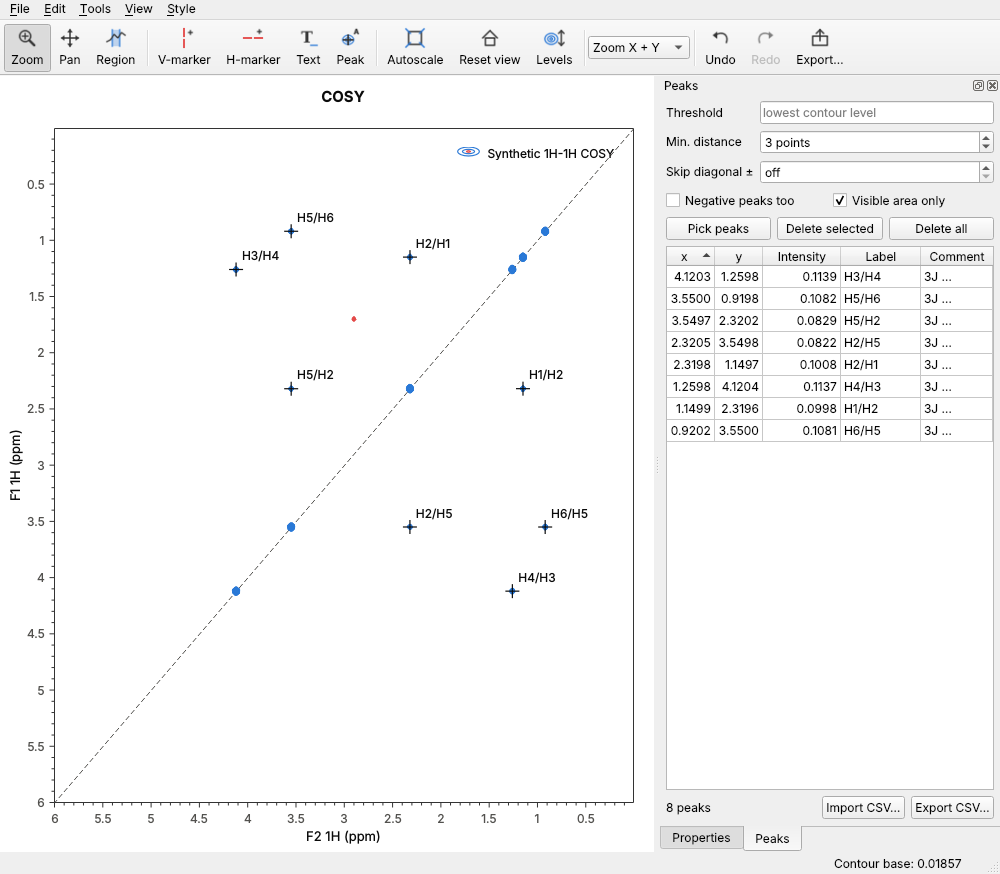
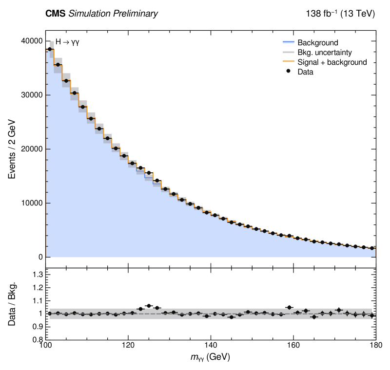
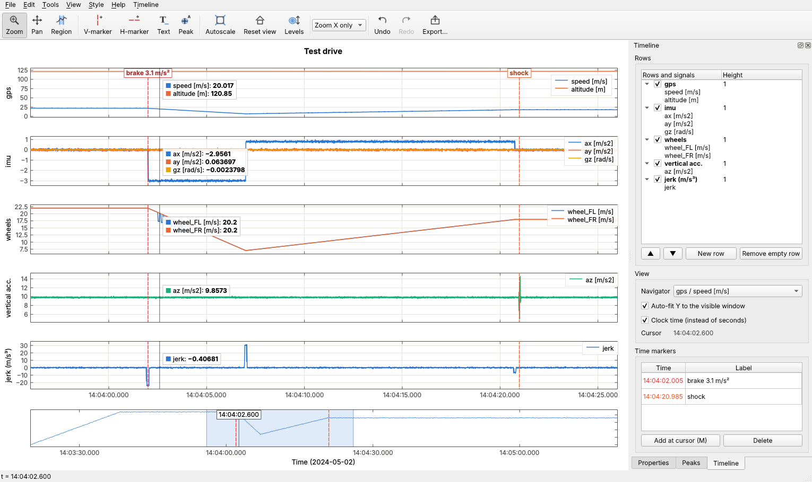

# Graphplot

*by Justinas Minkevicius · proprietary, all rights reserved (see [LICENSE](LICENSE))*

An interactive scientific plotting application in C++20 / Qt 6, controllable
from Python with NumPy arrays.

C++/Qt handles plotting, rendering and mouse interaction. Python handles
numerical analysis: create figures, send arrays, let the user mark, select and
annotate, read the results back, process, and re-plot.

| 2D NMR: picking and assigning cross peaks | Publication style (HEP-like) |
|---|---|
|  |  |



## Features

**Plotting**
- Overlaid 1D datasets: lines, symbols, step histograms, filled areas,
  uncertainty bands between two curves, and x/y error bars (symmetric or
  asymmetric).
- 2D data as contour plots, with TopSpin-style geometric levels that you
  **scroll with the mouse wheel**. Negative levels can be shown, with an
  optional colour-map image underneath.
- Multi-panel figures: subplots, ratio/residual panels with touching frames,
  shared axes.
- Linear or logarithmic axes, which can also be reversed (ppm convention).

**NMR**
- Opens Bruker TopSpin processed 2D spectra (`pdata/N/2rr`) directly, with
  ppm axes, nucleus labels and the diagonal.
- **Peak picking:** automatic picking above the lowest visible contour, with
  an option to skip the diagonal so only cross peaks are picked. Manual
  picking with the Peak tool, where a click snaps to the nearest maximum.
- **Assignments:** each peak has a label shown on the plot (e.g. `H3/C5`)
  and a longer comment that is kept off the plot.
- Labels can be dragged away from crowded peaks; a leader line is then drawn.
- A peak table with sorting and editing, plus CSV export/import.

**Sensor logs (timeline)**
- IMU, GPS, CAN or any other CSV logs appear as stacked rows on **one time
  axis**.
- **Navigator strip:** at the bottom, with a movable and resizable window
  that all rows follow.
- **Cursor line:** a vertical line through all rows follows the mouse and
  shows **every signal's value** at that moment.
- **Time markers:** draw one through all rows with Ctrl+click or `M`.
- **Rows:** drag to reorder them, move signals between rows, hide them or
  resize them.
- **Y axes:** each row automatically fits Y to the visible window.
- **Time formats:** epoch s, ms, µs or ns and ISO date-times are aligned on
  one clock. The axis shows seconds or clock time.

**Interaction**
- Wheel and rectangle zoom, pan, autoscale, and reset to the home view.
- X-region selection, markers and text annotations.
- Everything is draggable and editable, with undo/redo for every edit
  (mouse, panel or Python).

**Appearance**
- Every visual setting comes from a **style**, never from code.
- Built-in styles:
  - `default`;
  - `science` (CERN/ROOT-like: inward ticks on all sides, minor ticks,
    Helvetica-like font, accessible colour cycle);
  - `nmr`;
  - `presentation`.
- Plain-text `.gpstyle` files that you can edit, load, save and inherit
  from, plus your own default style that is loaded automatically.
- Math in all texts: `$m_{\gamma\gamma}$`, `$\delta$(${}^{1}$H)`,
  `**CMS** *Preliminary*`.
- Export to PNG (high-DPI), and to SVG and PDF as true vector output.

**Python**
- `plotter`: the full API.
- `plotter.pyplot`: a matplotlib-compatible layer, so many existing scripts
  run after changing the import.

## Building

Requirements:

- A C++20 compiler
- CMake ≥ 3.21
- Qt ≥ 6.2 with the Widgets, PrintSupport and Svg modules
- For Python: Python ≥ 3.8, pybind11 and NumPy

QCustomPlot 2.1.1 is vendored in `third_party/`.

```bash
sudo apt install build-essential cmake qt6-base-dev qt6-svg-dev libgl1-mesa-dev
```

```bash
pip install pybind11 numpy
```

```bash
cmake -S . -B build -DCMAKE_BUILD_TYPE=Release
```

```bash
cmake --build build -j
```

```bash
ctest --test-dir build --output-on-failure
```

Options: `-DGRAPHPLOT_BUILD_PYTHON=OFF` and `-DGRAPHPLOT_BUILD_TESTS=OFF`. On
macOS/Windows, add `-DCMAKE_PREFIX_PATH=/path/to/Qt/6.x/<platform>`.

## Quick start

The application:

```bash
./build/graphplot
```

```bash
./build/graphplot data.csv
```

```bash
./build/graphplot path/to/experiment/1
```

```bash
./build/graphplot --demo2d
```

- With no arguments, the app shows 1D demo data.
- `data.csv` stands for a column file: X followed by one or more Y columns.
- A folder argument opens a Bruker 2D spectrum. It can be the experiment
  folder or its `pdata/N` folder.
- `--demo2d` shows a synthetic 2D spectrum.

Python:

```bash
export PYTHONPATH=$PWD/build/python
```

```bash
python examples/make_sample_nmr.py
```

```bash
python examples/nmr_cross_peaks.py
```

```bash
python examples/hep_style.py
```

```bash
python examples/matplotlib_port.py
```

- `make_sample_nmr.py` writes a synthetic COSY to `sample_nmr/` in Bruker
  format.
- `nmr_cross_peaks.py` opens it, picks the cross peaks, assigns them and
  exports the peak list.
- `hep_style.py` draws histograms, data points, an uncertainty band and a
  ratio panel.
- `matplotlib_port.py` is an existing matplotlib script with only the import
  changed.

### 2D NMR: cross peaks

```python
import plotter

fig = plotter.figure()
spec = fig.open_bruker("~/data/cosy/1")             # ppm axes, TopSpin orientation
spec.scale_levels(0.5)                              # lower the contours (same as one '*' key press)
cross = fig.pick_peaks(exclude_diagonal=0.1)        # off-diagonal peaks in the visible area
for p in cross:
    print(p.x, p.y, p.intensity)
cross[0].label = "H3/C5"                            # shown on the plot
cross[0].comment = "dd, J = 7.2 / 1.5 Hz; check HMBC"   # kept off the plot
fig.export_peaks("peaks.csv")
fig.show()
```

### Sensor logs: timeline

```bash
./build/graphplot --timeline imu.csv gps.csv wheels.csv
```

In the app, *File → Open time series (CSV)…* (Ctrl+T) does the same. From
Python:

```python
import plotter

tl = plotter.timeline("Test drive")
tl.load_csv("imu.csv", "gps.csv", "wheels.csv")    # one row per file
tl.clock_time = True                               # 14:03:27.250 instead of seconds
tl.window = (40, 50)                               # visible time window (s)
print(tl.values_at(42.0))                          # every signal at t = 42 s
tl.pin(42.0, "hard braking")                       # time marker through all rows
row = tl.add_row("jerk")                           # computed signals in new rows
row.plot(t, jerk, label="jerk")
tl.show()
```

CSV format:

- One time column. It is named `time`, `t`, `timestamp`, `datetime`, …, or
  it is the first column.
- One or more signal columns.
- Separators: `,`, `;`, tab or spaces.
- Time values:
  - seconds;
  - Unix epoch in s, ms, µs or ns (detected automatically);
  - ISO date-times.
- Files with different sampling rates are aligned on one clock.

`examples/make_sample_vehicle.py` writes synthetic logs to try this, and
`examples/vehicle_timeline.py` loads them. It then detects braking events in
NumPy, pins them, and adds a derived jerk signal.

| Timeline action | How |
|---|---|
| Read values at a moment | move the mouse over the rows: the cursor line shows every signal's value |
| Move the time window | drag the shaded band in the navigator; drag its edges to resize; wheel to zoom; click to jump; double-click for everything |
| Zoom / pan time | wheel or drag in any row (zooms time only; Shift+wheel zooms that row's Y) |
| Time marker | Ctrl+click in a row, or `M` at the cursor; drag to move; right-click to rename/delete; double-click a marker in the Timeline tab to jump to it |
| Rearrange | Timeline tab: drag rows; drag a signal onto another row; tick to hide; edit names and heights; *New row* |
| Options | Timeline tab / menu: navigator signal, auto-fit Y, clock time |

### Publication style and matplotlib scripts

```python
import plotter.pyplot as plt               # instead of matplotlib.pyplot
plt.style.use("science")                   # or your own file: plt.style.use("thesis.gpstyle")
fig, (ax, rax) = plt.subplots(2, 1, sharex=True, gridspec_kw={"height_ratios": [3, 1], "hspace": 0})
ax.hist(mc, bins=edges, histtype="stepfilled", label="Simulation")
ax.errorbar(x, n, yerr=n**0.5, fmt="ko", label="Data")
ax.set_yscale("log"); ax.legend()
rax.errorbar(x, n / mc_counts, yerr=n**0.5 / mc_counts, fmt="ko")
fig.native.set_style({"label.top.left": "**CMS** *Preliminary*",
                      "label.top.right": "138 fb$^{-1}$ (13 TeV)"})
plt.savefig("plot.pdf")
```

## Mouse and keyboard

| Action | How |
|---|---|
| Zoom | `Z` tool and drag a rectangle; wheel (Ctrl: X only, Shift: Y only; over an axis: that axis) |
| Pan | `P` tool, or middle-drag in any tool |
| Select an X region | `R` tool and drag; drag its edges; Shift+drag inside to move it |
| Markers / text | `V` / `H` / `T`, then click |
| **Pick a peak** | `K` (Peak tool), then click (snaps to the maximum; Shift: exactly at the cursor); Esc leaves the tool |
| **Automatic peak picking** | Peaks tab → *Pick peaks*, or `Ctrl+Shift+K` |
| Move an object or a peak label | drag it (in any tool) |
| Edit an object | double-click it, or use the Properties / Peaks tabs |
| **Scroll contour levels** | **Alt + wheel**, or the plain wheel with **Levels** (`L`) on; `*` / `/` = ÷2 / ×2 |
| Autoscale / reset view | `A` (or double-click the plot) / `Home` |
| Delete / undo / redo | `Del` / `Ctrl+Z` / `Ctrl+Shift+Z` |
| Styles | *Style* menu: built-ins, *Edit style…*, load/save `.gpstyle`, *Use as my default style* |

In multi-panel figures, the panel you click becomes current; the side panels
then show its objects.

## Styles

```text
# thesis.gpstyle
inherit: science
font.size: 11
axes.prop_cycle: #1b9e77, #d95f02, #7570b3
label.top.left: "**My Experiment** *Preliminary*"
```

- Every key is listed with defaults and descriptions in
  [docs/STYLE_REFERENCE.md](docs/STYLE_REFERENCE.md).
- A complete example file is [docs/example_science.gpstyle](docs/example_science.gpstyle).
- Your default style lives at `~/.config/Graphplot/default.gpstyle` (or
  `$GRAPHPLOT_STYLE`). *Style → Use as my default style* writes it, and it
  is loaded on every start.

## Documentation

- [docs/PYTHON_API.md](docs/PYTHON_API.md): the Python reference, including
  peaks, styles, subplots and pyplot.
- [docs/ARCHITECTURE.md](docs/ARCHITECTURE.md): layout, layers, and the
  technical difficulties and their solutions.
- [docs/STYLE_REFERENCE.md](docs/STYLE_REFERENCE.md): all style keys.

## Author and license

**Author:** Justinas Minkevicius <oompagoo@gmail.com>

Copyright (c) 2026 Justinas Minkevicius. All rights reserved.

Any use of this software is prohibited without the author's prior written
permission. This includes commercial, personal, private, educational and
research use. To request permission, write to the address above. See
[LICENSE](LICENSE) for the full terms.

Third-party code keeps its own license and is excluded from these terms.
QCustomPlot (`third_party/qcustomplot`) is licensed under GPLv3; see the note
in [LICENSE](LICENSE) about distributing builds that include it.
