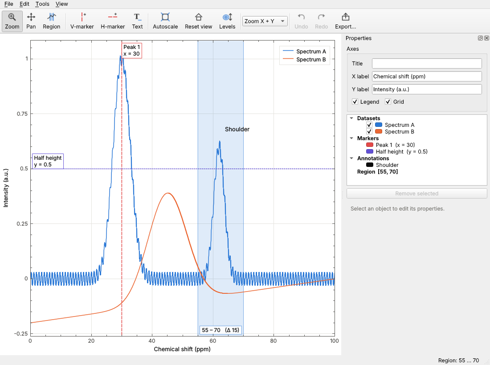
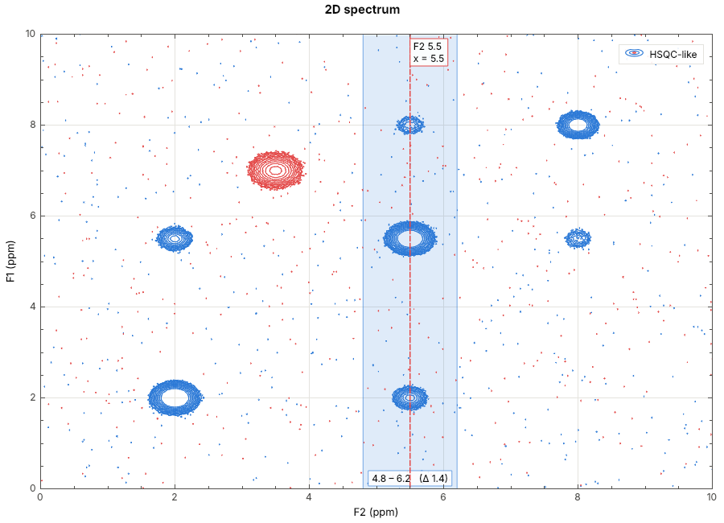

# Graphplot

A lightweight, interactive scientific plotting application in C++20 / Qt 6,
controllable from Python with NumPy arrays.

C++/Qt handles plotting, rendering and mouse interaction. Python handles
numerical analysis: create a figure, send arrays, let the user mark and select
regions, read the selection back, process, and re-plot.



Features:

- **Curves:** many overlaid 1D datasets with individual colour, line style,
  width, symbols and visibility, plus a legend. Large datasets stay fast
  thanks to QCustomPlot's adaptive sampling.
- **2D data:** contour plots with TopSpin-style geometric levels that you can
  **scroll with the mouse wheel**. You can also show positive and negative
  levels, and an optional colour-map image underneath.
- **Navigation:** wheel zoom around the cursor (X only, Y only, or both),
  rectangle zoom, pan, autoscale, and reset to the home view.
- **Region selection:** select an X range and drag its edges. The selection
  is stored in data coordinates and can be read from Python.
- **Markers:** vertical and horizontal markers are persistent objects. You
  can drag them, edit their label, colour and style, and they show their
  coordinate.
- **Annotations:** text annotations anchored in data coordinates. Drag them
  or edit their text, colour and font size.
- **Undo/redo:** every edit is undoable through `QUndoStack`, whether it was
  made with the mouse, the property panel or Python.
- **Export:** PNG (high-DPI), plus SVG and PDF as true vector output.

## Building

Requirements:

- A C++20 compiler (GCC 11+, Clang 14+, MSVC 2022)
- CMake ≥ 3.21
- Qt ≥ 6.2 with the Widgets, PrintSupport and Svg modules
- For the Python module: Python ≥ 3.8, pybind11 and NumPy

QCustomPlot 2.1.1 is vendored in `third_party/`, so you don't need to install it.

Ubuntu 24.04:

```bash
sudo apt install build-essential cmake qt6-base-dev qt6-svg-dev libgl1-mesa-dev
```

```bash
pip install pybind11 numpy
```

Build and run the tests:

```bash
cmake -S . -B build -DCMAKE_BUILD_TYPE=Release
```

```bash
cmake --build build -j
```

```bash
ctest --test-dir build --output-on-failure
```

Options: `-DGRAPHPLOT_BUILD_PYTHON=OFF` skips the Python module, and
`-DGRAPHPLOT_BUILD_TESTS=OFF` skips the tests. On macOS/Windows, point CMake
at Qt with `-DCMAKE_PREFIX_PATH=/path/to/Qt/6.x/<platform>`.

## Running the application

```bash
./build/graphplot
```

```bash
./build/graphplot data.csv
```

```bash
./build/graphplot --demo2d
```

- With no arguments, the app shows 1D demo data.
- With file arguments, it opens column files: the first column is X and each
  further column becomes one dataset.
- `--demo2d` shows a synthetic 2D spectrum for trying out contour levels.

*File → Open 2D matrix…* reads a grid of numbers: one row per y value. An
optional `# extent: x0 x1 y0 y1` line sets the axis coordinates.

### Mouse and keyboard

| Action | How |
|---|---|
| Zoom (rectangle) | `Z` tool, drag |
| Zoom (wheel) | wheel over the plot; Ctrl = X only, Shift = Y only; wheel over an axis zooms that axis |
| Pan | `P` tool and drag, or middle-drag in any tool |
| Select X region | `R` tool, drag; drag its edges to adjust; Shift+drag inside to move it |
| Vertical / horizontal marker | `V` / `H`, then click |
| Text annotation | `T`, then click (the text field opens in the panel) |
| Move a marker or annotation | drag it, in any tool |
| Edit an object | double-click it, or right-click → Edit, or use the Properties panel |
| Delete selected object | `Del` |
| Autoscale / Reset view | `A` (or double-click empty plot area) / `Home` |
| **Scroll contour levels** | **Alt + wheel** in any tool, or the plain wheel with **Levels** (`L`) on |
| Lower / raise contour levels ×2 | `*` / `/` (or ÷2 / ×2 in the panel) |
| Undo / Redo | `Ctrl+Z` / `Ctrl+Shift+Z` (`Ctrl+Y`) |
| Cancel a drag | `Esc` (restores the state from before the drag) |

Wheel up lowers the contour levels, which reveals weaker features. One
continuous scroll counts as a single undo step. Scrolling affects the 2D
dataset selected in the panel, or every visible one if none is selected.



## Python

```bash
export PYTHONPATH=$PWD/build/python
```

```bash
python examples/demo.py
```

```python
import numpy as np
import plotter

x = np.linspace(0, 100, 2000)
y1 = np.sin(x)

fig = plotter.figure()
fig.plot(x, y1, label="Signal 1", color="blue")
fig.plot(x, np.cos(x), label="Signal 2", color="red")
fig.marker(25.0, color="green", label="Marker 1")
fig.show()                                   # blocks in scripts, returns at the prompt

xmin, xmax = fig.get_selected_region()       # after selecting with the mouse
fig.plot(x, y1 - np.mean(y1), label="Corrected signal", color="black")

c = fig.contour(z, x=f2_axis, y=f1_axis)     # 2D data, z[row=y, col=x]
c.scale_levels(0.5)                          # same as one '*' key press
```

At the interactive prompt (`python -i`, the plain REPL, or IPython after
`%gui plotter`), windows stay fully interactive while you type. See
[docs/PYTHON_API.md](docs/PYTHON_API.md) for the complete API, and
`examples/` for runnable scripts.

To install the module into the active environment instead of setting
`PYTHONPATH`, run:

```bash
cmake --install build --prefix "$(python -c 'import site; print(site.getsitepackages()[0])')"
```

## Documentation

- [docs/ARCHITECTURE.md](docs/ARCHITECTURE.md): directory layout, layers and
  how they communicate, plus the technical difficulties and how they were
  solved.
- [docs/PYTHON_API.md](docs/PYTHON_API.md): Python reference.
- The C++ API is documented in the headers. Start with `src/model/PlotModel.h`,
  `src/commands/PlotEditor.h` and `src/gui/FigureWindow.h`.

## License note

QCustomPlot is licensed under **GPLv3**. Distributing a binary that links it
makes the combined work subject to the GPL. Commercial QCustomPlot licences
are available from its author, and the renderer is isolated in `src/render`
if you ever need to replace the library.
