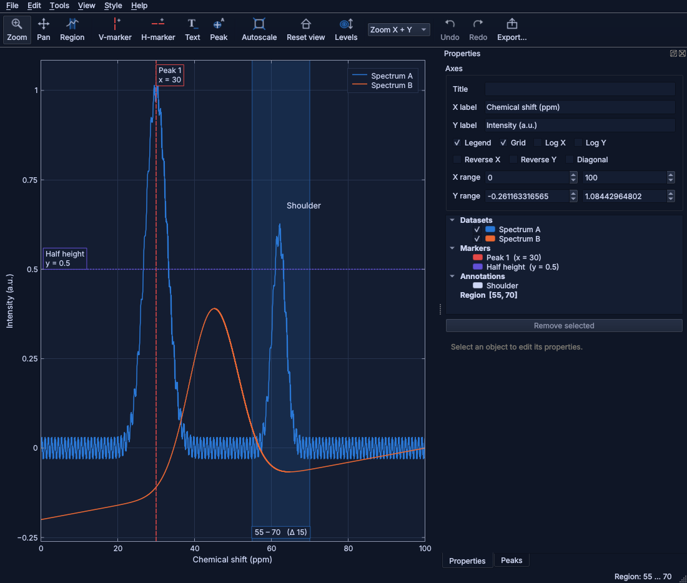

# Graphplot

*by Justinas Minkevicius · proprietary, all rights reserved (see [LICENSE](LICENSE))*

An interactive scientific plotting application in C++20 / Qt 6, controllable
from Python with NumPy arrays.

C++/Qt handles plotting, rendering and mouse interaction. Python handles
numerical analysis: create figures, send arrays, let the user mark, select and
annotate, read the results back, process, and re-plot.

| 2D NMR: picking and assigning cross peaks | Publication style (HEP-like) |
|---|---|
|  |  |




## Features

**Plotting**
- Overlaid 1D datasets: lines, symbols, step histograms, filled areas,
  uncertainty bands between two curves, and x/y error bars (symmetric or
  asymmetric).
- 2D data as contour plots, with TopSpin-style geometric levels that you
  **scroll with the mouse wheel**. Negative levels can be shown, with an
  optional colour-map image underneath.
- Multi-panel figures: subplots, ratio/residual panels with touching frames,
  shared axes.
- **Colour-mapped images** (heat maps, `imshow`) with perceptually uniform
  colour maps (viridis, magma, inferno, plasma, cividis, …) and a colour bar;
  on their own or under contour lines.
- Linear or logarithmic axes, which can also be reversed (ppm convention).

**NMR**
- Opens Bruker TopSpin processed 2D spectra (`pdata/N/2rr`) directly, with
  ppm axes, nucleus labels and the diagonal.
- **Peak picking:** automatic picking above the lowest visible contour, with
  an option to skip the diagonal so only cross peaks are picked. Manual
  picking with the Peak tool, where a click snaps to the nearest maximum.
- **Assignments:** each peak has a label shown on the plot (e.g. `H3/C5`)
  and a longer comment that is kept off the plot.
- Labels can be dragged away from crowded peaks; a leader line is then drawn.
- A peak table with sorting and editing, plus CSV export/import.

**Sensor logs (timeline)**
- IMU, GPS, CAN or any other CSV logs appear as stacked rows on **one time
  axis**.
- **Navigator strip:** at the bottom, with a movable and resizable window
  that all rows follow.
- **Cursor line:** a vertical line through all rows follows the mouse and
  shows **every signal's value** at that moment.
- **Time markers:** draw one through all rows with Ctrl+click or `M`.
- **Rows:** drag to reorder them, move signals between rows, hide them or
  resize them.
- **Y axes:** each row automatically fits Y to the visible window.
- **Time formats:** epoch s, ms, µs or ns and ISO date-times are aligned on
  one clock. The axis shows seconds or clock time.

**Themes and help**
- **Dark mode:** *View → Appearance* offers System, Light, Dark, Dim,
  Midnight, Solarized dark and High contrast. Dark themes recolour the
  windows and, on screen, the plots; exports and the clipboard keep the
  figure's light publication colours unless you choose otherwise.
- **Hover explanations:** resting the mouse on any button, field or menu
  entry explains what it does; switch them off (or on) in the same menu.
- Both settings are remembered and shared with Python scripts
  (`plotter.theme("dark")`, `plotter.tooltips(False)`).

**Interaction**
- Wheel and rectangle zoom, pan, autoscale, and reset to the home view.
- X-region selection, markers and text annotations. The selected region
  shows **statistics** of every line (mean ± sd, min/max and where, RMS,
  integral).
- Typed axis limits, and **Previous / Next view** history (Alt+Left/Right).
- Drop data files, Bruker folders, figures or `.gpstyle` files onto a window
  to open them; copy the figure to the clipboard with Ctrl+Shift+C.
- **Save your work:** *File → Save figure* (Ctrl+S) keeps everything in one
  `.gpfig` file (data, peaks with labels and comments, markers, notes,
  styles, panels, timeline) to continue later; *Open recent* reopens files.
- **Export data**, not only pictures: the visible curves (or just the
  selected region) as CSV; *Copy statistics* puts the region statistics on
  the clipboard for a spreadsheet.
- Everything is draggable and editable, with undo/redo for every edit
  (mouse, panel or Python).

**Styles**
- Every visual setting comes from a **style**, never from code.
- Built-in styles:
  - `default`;
  - `science` (CERN/ROOT-like: inward ticks on all sides, minor ticks,
    Helvetica-like font, accessible colour cycle);
  - `nmr`;
  - `presentation`.
- Plain-text `.gpstyle` files that you can edit, load, save and inherit
  from, plus your own default style that is loaded automatically.
- Math in all texts: `$m_{\gamma\gamma}$`, `$\delta$(${}^{1}$H)`,
  `**CMS** *Preliminary*`.
- Export to PNG (high-DPI), and to SVG and PDF as true vector output.

**Python**
- `plotter`: the full API.
- `plotter.pyplot`: a matplotlib-compatible layer, so many existing scripts
  run after changing the import.

## Building

Requirements:

- A C++20 compiler (GCC ≥ 11, Clang ≥ 14, MSVC 2022)
- CMake ≥ 3.21
- Qt ≥ 6.2 with the Widgets, PrintSupport and Svg modules (Test for the tests)
- For Python: Python ≥ 3.8 with its development headers, pybind11 and NumPy

QCustomPlot 2.1.1 is vendored in `third_party/`.

**Debian / Ubuntu** (everything from the distribution, no `pip` needed):

```bash
sudo apt install build-essential cmake qt6-base-dev qt6-svg-dev libgl1-mesa-dev python3-dev pybind11-dev python3-numpy
```

Or, in a virtual environment, take pybind11 and NumPy from pip (recent
distributions refuse `pip install` into the system Python):

```bash
python3 -m venv ~/.venvs/graphplot && . ~/.venvs/graphplot/bin/activate && pip install pybind11 numpy
```

Configure, build and test:

```bash
cmake -S . -B build -DCMAKE_BUILD_TYPE=Release
```

```bash
cmake --build build -j
```

```bash
ctest --test-dir build --output-on-failure
```

Options:

- `-DGRAPHPLOT_BUILD_PYTHON=OFF`: the application only.
- `-DGRAPHPLOT_BUILD_TESTS=OFF`: skip the tests.
- `-DPython_EXECUTABLE=/path/to/python3`: build the module for that Python
  (it only loads in the Python it was built for).
- **macOS / Windows:** install Qt with the Qt online installer and add
  `-DCMAKE_PREFIX_PATH=/path/to/Qt/6.x/<platform>` (e.g. `macos`,
  `msvc2022_64`). On Windows, run the commands in the *x64 Native Tools
  Command Prompt* and put Qt's `bin` folder on `PATH`.

Build problems are covered in [docs/TROUBLESHOOTING.md](docs/TROUBLESHOOTING.md#building).

## Installing (optional)

Without installing, run the app as `./build/graphplot` and make Python find
the package with `export PYTHONPATH=$PWD/build/python`. To install
permanently, install the app to a prefix and the Python package straight
into your (user or virtual-environment) `site-packages`:

```bash
cmake -S . -B build -DGRAPHPLOT_PYTHON_INSTALL_DIR="$(python3 -c 'import sysconfig; print(sysconfig.get_path("platlib"))')"
```

```bash
cmake --build build -j && cmake --install build --prefix ~/.local
```

This puts `graphplot` in `~/.local/bin` and `plotter` where `import plotter`
finds it. (Inside a virtual environment, `platlib` is the environment's
`site-packages`; for the system Python use `python3 -m site --user-site`.)

## Getting started: your first plot from Python

```python
import numpy as np
import plotter

x = np.linspace(0, 10, 500)
fig = plotter.figure("First plot")
fig.plot(x, np.sin(x), label="sin")
fig.plot(x, np.cos(x), label="cos", style="--")
fig.xlabel, fig.ylabel = "Time (s)", "Amplitude"
fig.legend()
fig.show(block=False)            # the window opens; the script continues

region = fig.wait_for_region()   # drag along X with the Region tool (R)
if region is not None:           # None if you closed the window
    stats = fig.region_stats()
    print(f"mean of sin in {region}: {stats['sin']['mean']:.3f}")
    m = fig.region_mask(x)
    fig.plot(x[m], np.sin(x[m]) ** 2, label="sin² (region)")
fig.savefig("first_plot.png")    # also .svg / .pdf
plotter.show()                   # keep the window open until you close it
```

What happens:

1. `fig.show(block=False)` opens the window and returns at once.
2. `wait_for_region()` keeps the window responsive until you drag a region,
   then returns `(xmin, xmax)`.
3. The script computes something from the selection and plots it back into
   the same window; every edit can be undone with Ctrl+Z.

At an interactive prompt (`python -i`, or IPython after `%gui plotter`) the
window stays live while you type, so you can do all of this step by step.
More: `examples/demo.py` (the full tour: markers, callbacks, region
analysis) and `examples/live_update.py` (streaming data from a worker
thread).

## Running the app and the examples

The application:

```bash
./build/graphplot
```

```bash
./build/graphplot data.csv
```

```bash
./build/graphplot path/to/experiment/1
```

```bash
./build/graphplot --demo2d
```

- With no arguments, the app shows 1D demo data.
- `data.csv` stands for a column file: X followed by one or more Y columns.
  Several files can be given at once.
- A folder argument opens a Bruker 2D spectrum. It can be the experiment
  folder, its `pdata/N` folder or the `2rr` file.
- `--demo2d` shows a synthetic 2D spectrum.
- `--timeline a.csv b.csv` opens sensor logs as a timeline (one row per file;
  add `--row-per-column` for one row per signal).
- `--export figure.pdf` renders the figure (plot only; `.png`, `.jpg`, `.svg`,
  `.pdf`) and exits. `--size 800x600` sets the figure size in pixels;
  `--scale 1` sets the pixel scale of PNG/JPG files (default 2, so an
  800x600 figure gives a 1600x1200 image); `--screenshot out.png` renders the whole window. Errors then go
  to the terminal with a non-zero exit code (for scripts and CI).
- `--version` prints the version.
- `--theme dark` uses a display theme for this session (`system`, `light`,
  `dark`, `dim`, `midnight`, `solarized-dark`, `high-contrast`).
- `--help` lists the options.

Python:

```bash
export PYTHONPATH=$PWD/build/python
```

```bash
python examples/make_sample_nmr.py
```

```bash
python examples/nmr_cross_peaks.py
```

```bash
python examples/hep_style.py
```

```bash
python examples/matplotlib_port.py
```

- `make_sample_nmr.py` writes a synthetic COSY in Bruker format; open it
  from `sample_nmr/cosy/1` (the experiment folder).
- `nmr_cross_peaks.py` opens it, picks the cross peaks, assigns them and
  exports the peak list.
- `hep_style.py` draws histograms, data points, an uncertainty band and a
  ratio panel.
- `matplotlib_port.py` is an existing matplotlib script with only the import
  changed.

### 2D NMR: cross peaks

```python
import plotter

fig = plotter.figure()
spec = fig.open_bruker("sample_nmr/cosy/1")         # experiment folder; ppm axes, TopSpin orientation
spec.scale_levels(0.5)                              # lower the contours (same as one '*' key press)
cross = fig.pick_peaks(exclude_diagonal=0.1)        # off-diagonal peaks in the visible area
for p in cross:
    print(p.x, p.y, p.intensity)
cross[0].label = "H3/C5"                            # shown on the plot
cross[0].comment = "dd, J = 7.2 / 1.5 Hz; check HMBC"   # kept off the plot
fig.export_peaks("peaks.csv")
fig.show()
```

### Sensor logs: timeline

```bash
./build/graphplot --timeline imu.csv gps.csv wheels.csv
```

In the app, *File → Open time series (CSV)…* (Ctrl+T) does the same. From
Python:

```python
import numpy as np
import plotter

tl = plotter.timeline("Test drive")
tl.load_csv("imu.csv", "gps.csv", "wheels.csv")    # one row per file
tl.clock_time = True                               # 14:03:27.250 instead of seconds
tl.window = (40, 50)                               # visible time window (s)
print(tl.values_at(42.0))                          # every signal at t = 42 s
tl.pin(42.0, "hard braking")                       # time marker through all rows

ax = tl.signal("ax [m/s2]")                        # a loaded signal (a Line), by column name
t, a = ax.x, ax.y                                  # its data as NumPy arrays
row = tl.add_row("jerk")                           # computed signals in new rows
row.plot(t, np.gradient(a, t), label="jerk")
tl.show()
```

CSV format:

- One time column. It is named `time`, `t`, `timestamp`, `datetime`, …, or
  it is the first column.
- One or more signal columns.
- Separators: `,`, `;`, tab or spaces.
- Time values:
  - seconds;
  - Unix epoch in s, ms, µs or ns (detected automatically);
  - ISO date-times.
- Files with different sampling rates are aligned on one clock.

`examples/make_sample_vehicle.py` writes synthetic logs to try this, and
`examples/vehicle_timeline.py` loads them. It then detects braking events in
NumPy, pins them, and adds a derived jerk signal.

| Timeline action | How |
|---|---|
| Read values at a moment | move the mouse over the rows: the cursor line shows every signal's value |
| Move the time window | drag the shaded band in the navigator; drag its edges to resize; drag outside it to draw a new window; wheel to zoom; click to jump; double-click for everything |
| Zoom / pan time | wheel or drag in any row (zooms time only; Shift+wheel zooms that row's Y); double-click empty space in a row, or `Shift+Home`, shows the whole recording |
| Time marker | Ctrl+click in a row, or `M` at the cursor; drag to move; double-click it (or right-click) to rename; right-click to delete; double-click a marker in the Timeline tab to jump to it |
| Step through markers | `[` / `]` centre the window on the previous / next marker; the navigator label shows Δt from the nearest marker |
| Rearrange | Timeline tab: drag rows; drag a signal onto another row; tick to hide; edit names and heights; *New row* |
| Options | Timeline tab / menu: navigator signal, auto-fit Y, clock time |

### Publication style and matplotlib scripts

```python
import plotter.pyplot as plt               # instead of matplotlib.pyplot
plt.style.use("science")                   # or your own file: plt.style.use("thesis.gpstyle")
fig, (ax, rax) = plt.subplots(2, 1, sharex=True, gridspec_kw={"height_ratios": [3, 1], "hspace": 0})
ax.hist(mc, bins=edges, histtype="stepfilled", label="Simulation")
ax.errorbar(x, n, yerr=n**0.5, fmt="ko", label="Data")
ax.set_yscale("log"); ax.legend()
rax.errorbar(x, n / mc_counts, yerr=n**0.5 / mc_counts, fmt="ko")
fig.native.set_style({"label.top.left": "**CMS** *Preliminary*",
                      "label.top.right": "138 fb$^{-1}$ (13 TeV)"})
plt.savefig("plot.pdf")
```

## Mouse and keyboard

Single-letter keys work while the plot has focus (not while you type in a
side panel). The timeline has its own table above.

**Tools** (toolbar, *Tools* menu; Esc leaves a tool and cancels a drag)

| Action | How |
|---|---|
| Zoom | `Z` tool and drag a rectangle; the wheel zooms in any tool (Ctrl: X only, Shift: Y only; over an axis: that axis). The toolbar's *Zoom X + Y / X only / Y only* box limits the rectangle |
| Pan | `P` tool, or middle-drag in any tool |
| Select an X region | `R` tool and drag; drag its edges; Shift+drag inside to move it; the region's statistics appear in Properties |
| Markers / text | `V` / `H` / `T`, then click |
| **Pick a peak** | `K` (Peak tool), then click (snaps to the maximum; Shift: exactly at the cursor) |
| Move an object or a peak label | drag it (in any tool) |
| Edit an object | double-click it, or use the Properties / Peaks tabs; right-click for *Edit…* / *Delete* |
| Right-click on empty space | *Vertical marker here*, *Horizontal marker here*, *Annotation here*, *Autoscale*, *Reset view* |

**View and contours**

| Action | How |
|---|---|
| Autoscale / X only / Y only | `A` (or double-click the plot) / *View → Autoscale X* / `Shift+A` |
| Reset view / set home | `Home` / *View → Set current view as home* |
| Previous / next view | `Alt+Left` / `Alt+Right` |
| Measure a distance | click one point, hover another: the status bar shows Δx and Δy from the last click next to the cursor coordinates |
| **Scroll contour levels** | **Alt + wheel**, or the plain wheel with **Levels** (`L`) on |
| Lower / raise contour levels | `*` (÷2, more contours) / `/` (×2) |
| **Automatic peak picking** | Peaks tab → *Pick peaks*, or `Ctrl+Shift+K` |

**Files and editing**

| Action | How |
|---|---|
| Open data / time series / Bruker | `Ctrl+O` / `Ctrl+T` / `Ctrl+B`; *File → Open 2D matrix…*; or drop files and folders on the window |
| Save / open a figure | `Ctrl+S` (*Save figure*), `Ctrl+Shift+S` (*Save as*), `Ctrl+Shift+O` (*Open figure*); *File → Open recent* |
| Export data | *File → Export data (CSV)…* / *Export region data (CSV)…*; Region page → *Copy statistics* |
| Export / copy figure | `Ctrl+E` (PNG, SVG, PDF) / `Ctrl+Shift+C` |
| Close window | `Ctrl+W` |
| Delete selected | `Del` or `Backspace` |
| Undo / redo | `Ctrl+Z` / `Ctrl+Shift+Z` or `Ctrl+Y` |
| Clear the region selection | *Edit → Clear region selection* |
| Styles | *Style* menu: built-ins, *Edit style…*, load/save `.gpstyle`, *Use as my default style* |
| Theme, hover explanations | *View → Appearance*: themes, "Dark themes also colour the plots", "Exports use the theme colours too", "Show explanations on hover" |

In multi-panel figures, the panel you click becomes current; the side panels
then show its objects.

## Styles

```text
# thesis.gpstyle
inherit: science
font.size: 11
axes.prop_cycle: #1b9e77, #d95f02, #7570b3
label.top.left: "**My Experiment** *Preliminary*"
```

- Every key is listed with defaults and descriptions in
  [docs/STYLE_REFERENCE.md](docs/STYLE_REFERENCE.md).
- A complete example file is [docs/example_science.gpstyle](docs/example_science.gpstyle).
- Your default style lives at `~/.config/Graphplot/default.gpstyle` (or
  `$GRAPHPLOT_STYLE`). *Style → Use as my default style* writes it, and it
  is loaded on every start.

## Documentation

- [docs/PYTHON_API.md](docs/PYTHON_API.md): the Python reference, including
  peaks, styles, subplots and pyplot.
- [docs/ARCHITECTURE.md](docs/ARCHITECTURE.md): layout, layers, and the
  technical difficulties and their solutions.
- [docs/STYLE_REFERENCE.md](docs/STYLE_REFERENCE.md): all style keys.
- [docs/FILE_FORMATS.md](docs/FILE_FORMATS.md): every file Graphplot reads or
  writes (column data, 2D grids, sensor logs, Bruker, peak lists, styles,
  exports) and the exact parsing rules.
- [docs/TROUBLESHOOTING.md](docs/TROUBLESHOOTING.md): build and import
  problems, frozen or vanishing windows, threads, data that loads wrongly,
  and the error messages explained.

## Author and license

**Author:** Justinas Minkevicius <oompagoo@gmail.com>

Copyright (c) 2026 Justinas Minkevicius. All rights reserved.

Any use of this software is prohibited without the author's prior written
permission. This includes commercial, personal, private, educational and
research use. To request permission, write to the address above. See
[LICENSE](LICENSE) for the full terms.

Third-party code keeps its own license and is excluded from these terms.
QCustomPlot (`third_party/qcustomplot`) is licensed under GPLv3; see the note
in [LICENSE](LICENSE) about distributing builds that include it.
